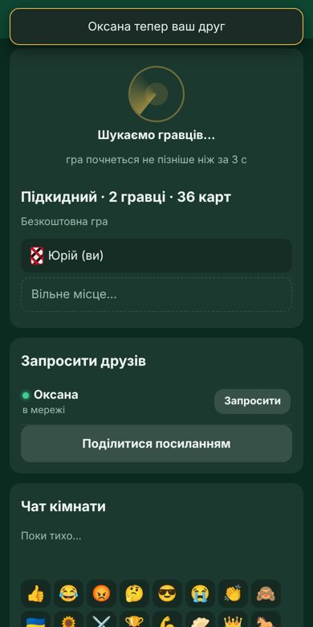
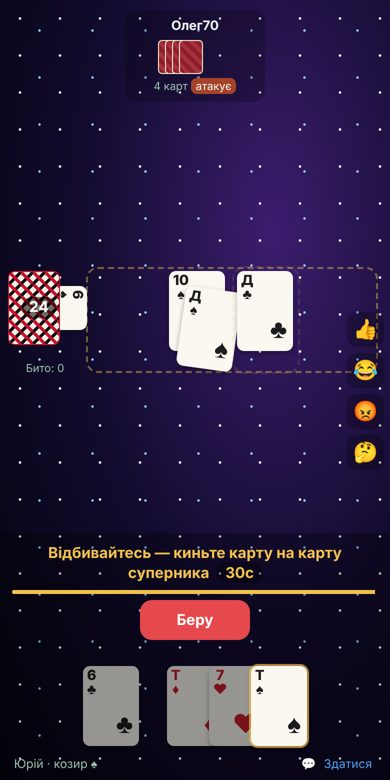
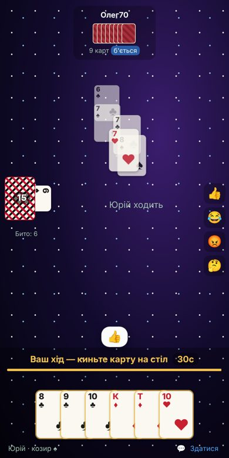
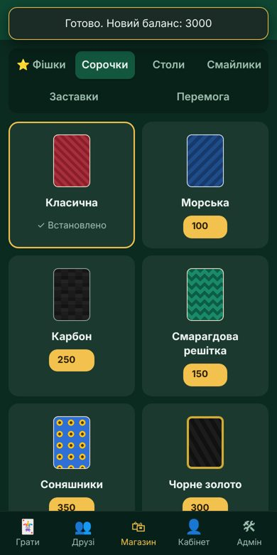
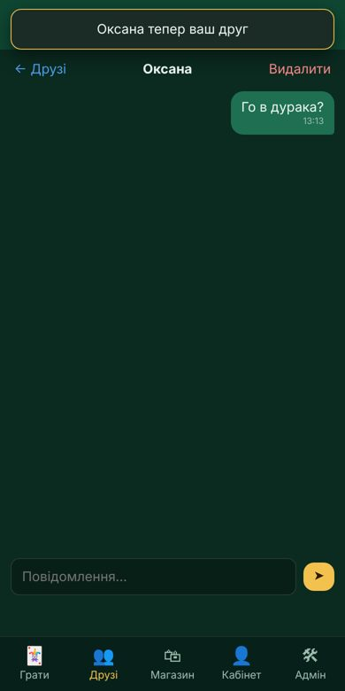
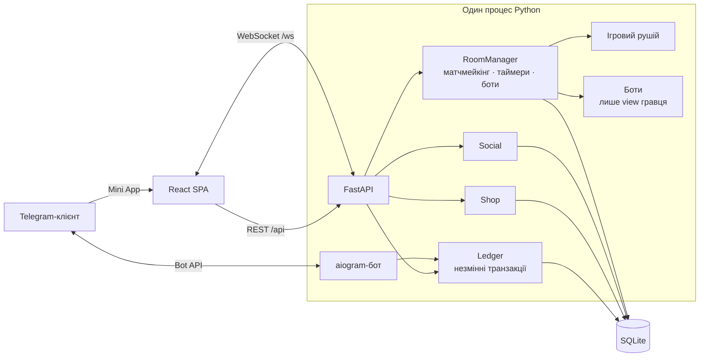

# ♠ Дурак онлайн — Telegram Mini App

[](https://github.com/Brebston/durak_online_bot/actions/workflows/ci.yml)


Карткова гра «Дурак» (підкидний і перевідний, 2–4 гравці) у вигляді Telegram Mini App. Включає матчмейкінг з автоматичним підбором суперників, друзів, чат, ігрову валюту за Telegram Stars і магазин оформлення.


<p align="center">
  
  
  
  
  
</p>

## Зміст

- [Можливості](#можливості)
- [Архітектура](#архітектура)
- [Швидкий старт](#швидкий-старт)
- [Конфігурація](#конфігурація)
- [Telegram Stars і фішки](#telegram-stars-і-фішки)
- [Команди бота](#команди-бота)
- [Розробка](#розробка)
- [Тести та CI](#тести-та-ci)
- [Безпека](#безпека)
- [Структура проєкту](#структура-проєкту)

## Можливості

| Розділ | Що є |
|---|---|
| **Гра** | Підкидний і перевідний; 2, 3 або 4 гравці; колода на 36 чи 52 карти; таймер ходу 20/30/60 с; кожен хід перевіряє сервер |
| **Керування** | Карту перетягують і кидають на стіл; вона прилітає з анімацією. При «бито» карти відлітають убік, при «беру» — до захисника. Як запасний варіант лишається натискання |
| **Матчмейкінг** | Одна кнопка «Знайти гру»: спершу шукає живих суперників із такими самими налаштуваннями, а якщо онлайн малий, за `BOT_FILL_SECONDS` підсаджує ботів |
| **Боти** | Три рівні; сильний бот використовує Монте-Карло по невідомих картах. Боти бачать лише свої карти й відкриту інформацію |
| **Кімнати** | Власні кімнати з назвою, видимі в загальному списку або доступні лише за запрошенням |
| **Соціальне** | Друзі, глобальний пошук гравців (можна приховати себе), особисті повідомлення, запрошення в кімнату (онлайн або через бота), чат кімнати, смайлики над гравцями |
| **Магазин** | Фішки за Telegram Stars; за фішки купуються сорочки карт, столи, набори смайликів, заставки та анімації перемоги. Усі дизайни оригінальні, зроблені на CSS |
| **Режим «Шулер»** | Галочка при виборі гри (і безкоштовної, і на фішки): можна відбиватися будь-якою картою й підкидати будь-що; помітив мухлювання — торкнися карти, і вона повертається мухлярові. Хибна тривога — до кінця відбою ловити не можна. |
| **Рівні** | Досвід за кожен матч (перемога 30, нічия 15, поразка 10, +5 за кожного додаткового суперника); рівень видно в профілі, біля імені за столом і в друзях; нагородні сорочки на 5, 10 і 20 рівнях |
| **Мови** | Українська, English, Polski, Русский — автоматично за мовою Telegram, перемикач у Кабінеті; бот теж відповідає мовою гравця |
| **Кабінет** | Баланс, статистика, історія матчів і транзакцій, налаштування, правила, підтримка |
| **Адмінка** | Баланси, банк гри, Stars-статистика, матчі та журнали, звернення, режими, аудит |

## Архітектура



- **Сервер — єдине джерело правди.** Клієнт отримує лише `view(гравець)`: власні карти, відкриту інформацію та список дозволених дій.
- **Гроші рахує бухгалтерія.** Кожна зміна балансу — незмінна транзакція. Ставки резервуються до старту матчу, повторний платіж не зараховується двічі.
- **Один контейнер.** FastAPI роздає зібраний фронтенд, обслуговує API й WebSocket та запускає бота в режимі polling.

## Швидкий старт

**Що потрібно:** Docker і публічна HTTPS-адреса (VPS або Cloudflare Tunnel).

```bash
cp .env.example .env               # заповніть BOT_TOKEN, WEBAPP_URL, ADMIN_IDS
docker compose up -d --build
```

Після запуску:

1. Напишіть боту `/start`, і з'явиться кнопка «Грати».
2. Поповніть банк гри, щоб боти могли грати на фішки: `/bank 10000 Стартовий банк`.

### Railway (хмара, автодеплой із GitHub)

У репозиторії вже є `railway.json` (збірка з Dockerfile, healthcheck `/api/health`). Сервер слухає порт зі змінної `PORT`.

1. **New Project → Deploy from GitHub repo** → оберіть репозиторій.
2. **Volume** з mount path `/data` — там зберігаються база й ключ роздач.
3. **Variables:** `BOT_TOKEN`, `ADMIN_IDS`, `WEBAPP_URL`, `DATA_DIR=/data` і решта змінних із таблиці нижче.
4. **Settings → Networking → Generate Domain** → вставте видану адресу в `WEBAPP_URL`.
5. **Settings → Source:** гілка `main`, увімкніть автодеплой і **Wait for CI** — тоді деплой відбувається лише після зелених тестів GitHub Actions.

> Кімнати зберігаються в памʼяті, тож під час деплою матчі, що йшли, скасовуються, а ставки автоматично повертаються.
> Тримайте **одну** репліку: SQLite і бот у режимі polling не масштабуються горизонтально.

### Cloudflare Tunnel (без власного сервера)

```bash
brew install cloudflared                          # macOS
cloudflared tunnel --url http://localhost:8000    # видасть https://….trycloudflare.com
```

Вставте видану адресу в `WEBAPP_URL` і перезапустіть: `docker compose up -d`. Тимчасова адреса змінюється після кожного перезапуску тунелю. Для постійної потрібен [іменований тунель](https://developers.cloudflare.com/cloudflare-one/connections/connect-networks/) зі своїм доменом.

## Конфігурація

Усі параметри задаються змінними середовища в `.env`. Частину з них (режими, ставки, комісію, ботів) адмін може змінити в панелі без перезапуску.

| Змінна | За замовчуванням | Опис |
|---|---|---|
| `BOT_TOKEN` | — | Токен від [@BotFather](https://t.me/BotFather) |
| `WEBAPP_URL` | `http://localhost:8000` | Публічна HTTPS-адреса Mini App |
| `ADMIN_IDS` | — | Telegram ID адміністраторів через кому |
| `STARS_TO_CHIPS` | `10` | Скільки фішок дає 1 ⭐ |
| `WITHDRAWAL_EUR_PER_STAR` | `0` | Орієнтовний EUR-курс для ручних заявок; `0` вимикає оцінку |
| `STAR_PACKS` | `25,50,100,250` | Пакети Stars у магазині |
| `STAKES` | `10,50,100,500` | Доступні ставки |
| `COMMISSION_PERCENT` | `0` | Комісія з програної ставки |
| `FREE_GAMES_PER_DAY` | `1` | Ліміт безкоштовних ігор (0 — без ліміту; на адмінів не діє) |
| `BOT_FILL_SECONDS` | `8` | Через скільки секунд «Знайти гру» підсаджує ботів |
| `DATA_DIR` | `./data` | База SQLite та ключ шифрування роздач |
| `DEV_MODE` | `0` | `1` — вхід без Telegram, **лише для локальної розробки** |

## Telegram Stars і фішки

**Гравці:**

- Купують фішки за Stars.
- Фішки — ігровий баланс: на них грають і купують оформлення. У профілі можна подати заявку на ручну виплату у Stars; заявку перевіряє адміністратор, а після схвалення виплачує вручну.
- Заявка резервує фішки до відхилення або завершення. Після схвалення адміністратор сам надсилає Stars користувачу в Telegram і фіксує підтвердження в адмінці. Бот не переказує Stars автоматично.
- Гравець відкриває нижнє меню Mini App → «Вивід», вводить суму кратну курсу та стежить за статусом там само. Telegram ID заявки визначається автоматично з авторизованого акаунта.
- Необов'язкову приблизну суму в євро задає `WITHDRAWAL_EUR_PER_STAR`; фактична ціна залежить від способу придбання Stars, платформи та регіону.
- Повернути Stars за невикористані фішки можна через `/paysupport`. Адмін робить це командою `/refund`.

**Власник бота:**

- Stars від оплат накопичуються на балансі бота. Поточну суму видно в «Адмін → Огляд».
- Виведення: профіль бота в Telegram → *Stars / Balance* → *Withdraw*, через [Fragment](https://fragment.com) у TON. Потім TON можна продати на біржі.
- Stars стають доступні для виведення приблизно через 21 день після оплати. Діють мінімальна сума та комісія Fragment; актуальні умови дивіться в Telegram.
- Альтернатива — витрачати Stars на рекламу в Telegram Ads.

**Боти й банк гри:** ставки ботів у грі на фішки покриває банк гри, який поповнює адмін. У безкоштовному режимі боти виглядають як звичайні гравці. У грі на фішки вони позначені 🤖.

## Команди бота

| Команда | Хто | Опис |
|---|---|---|
| `/start [room_<id>]` | усі | Кнопка гри / запрошення в кімнату |
| `/balance`, `/terms` | усі | Баланс, умови |
| `/support <текст>`, `/paysupport` | усі | Звернення до підтримки |
| `/give <id\|@username> <сума> <причина>` | адмін | Нарахувати (мінус — списати) фішки, зокрема собі |
| `/bank [<сума> <причина>]` | адмін | Банк гри |
| `/refund <user_id> <charge_id>` | адмін | Повернути Stars і списати фішки |

## Розробка

```bash
# бекенд
cd backend
python -m venv .venv && source .venv/bin/activate
pip install -r requirements-dev.txt
DEV_MODE=1 ADMIN_IDS=1 FREE_GAMES_PER_DAY=0 BOT_FILL_SECONDS=3 uvicorn app.main:app --reload

# фронтенд (в іншому терміналі)
cd frontend
npm ci
npm run dev        # http://localhost:5173/?dev=1&name=Юрій  (друга вкладка: ?dev=2)
```

## Тести та CI

```bash
cd backend && ruff check . && pytest      # рушій, боти, бухгалтерія, API, WebSocket-ігри
cd frontend && npm test && npm run build  # логіка drag-and-drop, збірка
```

GitHub Actions (`.github/workflows/ci.yml`) на кожен push і pull request:

1. **Backend:** `ruff` і `pytest`. Тести включають сотні симуляцій партій для всіх варіантів правил і повні ігри проти ботів через WebSocket.
2. **Frontend:** `vitest` і `vite build`.
3. **Docker:** збірка образу після успішних тестів.

Залежності оновлює Dependabot (`.github/dependabot.yml`).

## Безпека

- **Правила кімнати** перевіряються суворо за типами й межами: клієнт не може підсунути власні ліміти чи рядки замість чисел.
- **DEV_MODE** не працює, якщо задано `BOT_TOKEN`: випадково увімкнений режим розробника на бойовому сервері не відкриє вхід під чужим ID.
- **Заголовки:** `X-Content-Type-Options`, `Referrer-Policy`, `Permissions-Policy`, CSP `frame-ancestors` лише для Telegram, `no-store` для API; Swagger-документацію вимкнено.
- **WebSocket:** повідомлення понад 4 КБ і некоректний JSON ігноруються; тип кожного поля ходу перевіряється.
- **«Завислі» ставки:** кімнати очікування без жодного гравця онлайн понад 5 хвилин закриваються, резерви повертаються.
- **Ліміти:** не більше 50 непідтверджених заявок у друзі, 5 відкритих звернень у підтримку, адмін-коригування до 10⁹.
- **Режим «Шулер»:** які карти покладено нечесно, знає лише сервер; у журналі матчу це видно адміну тільки після гри.

- **Авторизація.** Підпис `initData` Telegram перевіряється на сервері. Клієнт не передає ні баланс, ні карти, ні результат.
- **Захист від повторів.** Кожен хід містить `version`, тому повторні й застарілі запити відхиляються.
- **Незмінність транзакцій.** Змінювати чи видаляти транзакції забороняють тригери SQLite. Платіж Stars зараховується рівно один раз за `charge_id`.
- **Приховані карти.** Під час гри їх не видно нікому, включно з адміном. Роздача зберігається зашифрованою. Відкрити її можна лише після матчу, і кожне відкриття пишеться в аудит.
- **Обмеження й журнали.** Діють ліміти частоти для API, ходів, чату й невдалих входів. Ведеться журнал авторизацій. Блокування акаунтів — лише з причиною.
- **Приватність.** Гравець може приховати себе з пошуку. Писати особисті повідомлення можна лише друзям.

> `DATA_DIR` містить базу й ключ `deal.key`. Робіть резервні копії й не публікуйте цю папку.

## Структура проєкту

```
durak/
├── backend/
│   ├── app/
│   │   ├── game/engine.py   # правила, перевірка ходів, view гравця
│   │   ├── game/bot_ai.py   # боти (легкий / середній / сильний)
│   │   ├── rooms.py         # кімнати, матчмейкінг, автоботи, таймери, чат
│   │   ├── ledger.py        # бухгалтерія фішок
│   │   ├── shop.py          # каталог і покупки оформлення
│   │   ├── social.py        # друзі, пошук, особисті повідомлення
│   │   ├── bot.py           # Telegram-бот, Stars
│   │   └── main.py          # FastAPI: REST + WebSocket
│   └── tests/
├── frontend/
│   └── src/
│       ├── screens/         # Lobby, Room, Friends, Shop, Profile, Admin
│       ├── dnd.js           # логіка drag-and-drop (+ dnd.test.js)
│       ├── Fx.jsx           # заставки та анімації перемоги
│       └── cosmetics.css    # сорочки, столи, ефекти
├── .github/workflows/ci.yml
├── Dockerfile
└── docker-compose.yml
```
